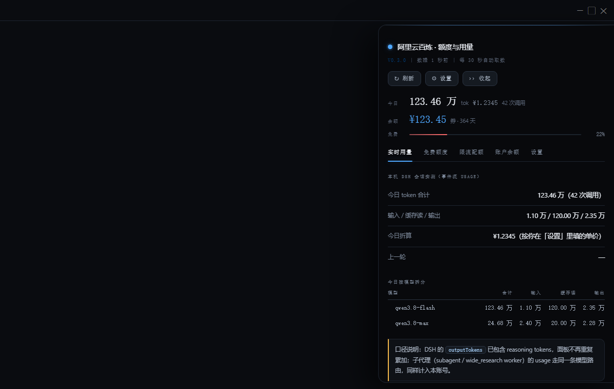
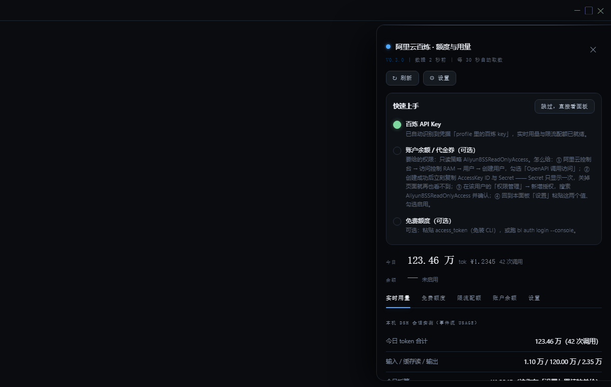
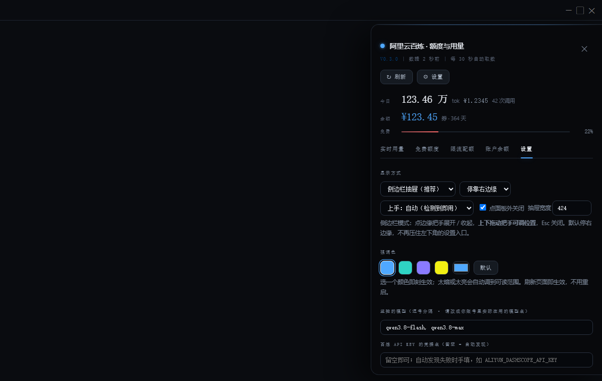
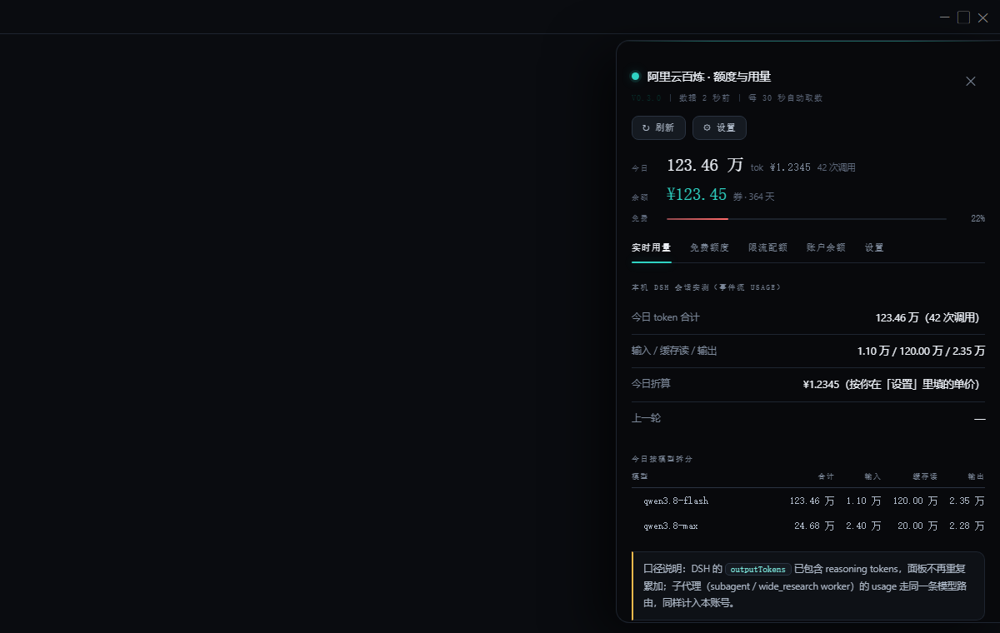

# dsh-bailian-balance

在 [DeepSeek Harness](https://github.com/deepseek-ai)（DSH）界面右边缘加一个把手，点开是**阿里云百炼额度与用量**面板：
今天烧了多少 token、折算多少钱、代金券还剩多少、免费额度哪一档最紧张、模型的限流配额是多少。

不代理请求、不改模型路由、不上传任何数据 —— 它只是把「我在百炼上花了多少」这件事放到你干活的地方。

| A 模式（默认）：检测到 key 就直接出数据 | B 模式：三步上手卡片，**数据照常显示在下面** |
|---|---|
|  |  |

## 装

```sh
# 1. 把本仓库保存到本地任意目录（git clone，或在 GitHub 上 Code → Download ZIP 后解压）。
#    确认该目录下能看到 package.json 与 cordis.patch.yml。

# 2. 装进你的 DSH profile（profile 名看 ~/.dsh/profiles/ 下有什么目录；不写 --profile 默认是 web）
dsh plugin --profile desktop add file:<上一步那个目录的绝对路径>

# 3. 回到 DSH 按 Ctrl+R
```

如果右边缘没出现把手，**重启一次 DSH 应用**（前端注入表是宿主启动时一次性收集的）。
之后改 **已装副本**（`~/.dsh/profiles/<profile>/node_modules/dsh-bailian-balance/assets/widget.js`）
只需刷新页面；改 clone 里的源码不会生效，要先覆盖过去。

## 装完立刻有什么

四路数据源各自独立、按可用性优雅降级 —— **一个都不配也能跑**：

| 数据 | 需要什么 | 拿不到时 |
|---|---|---|
| 今日 token / 调用次数 | 无（读 DSH 会话事件里的真实 usage） | — |
| 模型限流配额（TPM） | 复用 profile 里已有的 DashScope key | 提示去设置里配 key |
| 账户余额 / 代金券 | 一对 AK/SK（可选） | 显示「未启用」并告诉你怎么开 |
| 新人免费额度 | 控制台登录态（可选，见下） | 显示「未登录」并给两种开通方式 |

### ⚠️ 第一件事：把监控模型改成你自己的

默认监控 `qwen3.8-flash` / `qwen3.8-max`。**如果你账号里没有这两个模型，「免费额度」和「限流配额」两格会是空的** —— 那不是坏了。
到「设置」→「监控的模型」换成你实际在用的模型名，保存后立刻刷新。

### 金额折算

面板按你填的单价把 token 折算成钱；不填就只显示 token 数。
格式 `模型|输入|输出|缓存`（元/百万 token，缓存可留空），一行一个模型。

### 免费额度（两种开通方式，都不用改代码）

1. **粘贴 access_token**（推荐，免装 CLI）：登录[百炼控制台](https://bailian.console.aliyun.com/)后，
   从浏览器请求里取 `access_token`，粘到「设置」里。
2. **官方 CLI**：`npm i -g bailian-cli && bl auth login --console`，面板会自动读 `~/.bailian/config.json`。

> 为什么要绕这一圈：DashScope 的 `sk-` key **查不到余额**
> （`/compatible-mode/v1/dashboard/billing/*` 实测 404），免费额度只能走控制台网关。
> 原因与实测细节见代码注释与 CHANGELOG。

### 账户余额 / 代金券

「设置」里填 AccessKeyId / Secret 并勾选启用。
**强烈建议单建一个 RAM 子账号、只授 `AliyunBSSReadOnlyAccess`**，别用主账号 AK。
（官方文档里这个权限点有个拼写错误，照抄才生效 —— 见 `lib/index.js` 的签名注释。）

## 外观

| 设置页：预设 + 原生调色板 | 青碧 `#2FD4C4` |
|---|---|
|  |  |

- **强调色**：4 个预设（天蓝 / 青碧 / 紫电 / 酸黄）+ 原生调色板自选，点一下就生效。
  自选色会按 HSL 亮度**自动钳制到可读范围** —— 选个近黑色也不会把余额数字变看不见。
- **两种形态**：侧边抽屉（默认，可停靠左/右边缘、宽度可调、把手可拖动定位）或左下角胶囊。
- **两种上手模式**：`auto` 与 `wizard`，设置里瞬间切换，不用重装。

配色只暴露**一个**可调项（其余是固定中性色阶）—— 面对 12 个变量的话你只会想关掉面板。

## 隐私

- **无遥测、无第三方上报。** 所有网络请求都是从你本机直连阿里云官方端点
  （`dashscope.aliyuncs.com`、`bailian-cs.console.aliyun.com`、`business.aliyuncs.com`）。
- **密钥不进配置文件。** AK/SK 与粘贴的 access_token 都写进 DSH 官方凭据库
  （`~/.dsh/.credentials.yaml` 的 refs）；插件自己的 `~/.dsh/bailian-balance/config.json`
  里只有模型名、单价、外观这些非敏感项。
- 用量账本在本地 `~/.dsh/bailian-balance/ledger.json`，按天保留 60 天。
- 测试夹具全部是合成数据，不含任何真实账号信息。
- 环境变量 `BAILIAN_CONSOLE_HOST`（仅测试用）**被锁死为只能指向 127.0.0.1 / localhost**，
  否则它会把 `Authorization: Bearer <控制台 token>` 发往任意主机。

## 开发

```sh
node test/run-all.mjs      # 离线套件：零依赖、不发任何外部请求
node test/live-check.mjs   # 可选：会向阿里云发真实请求，需要本机凭据；没凭据时整体跳过
```

- 纯 vanilla JS，**零运行时依赖**，不需要 `npm install`，也没有构建步骤。
- 离线跑两套：凭据通道（127.0.0.1 假网关，含 dashscope 与控制台）+ 前端渲染冒烟（DOM 桩）。
  另有 `test/live-check.mjs` 用 mock root/ctx 驱动真实模块，但它**会向阿里云发真实请求**，
  所以不在 `run-all` 与 CI 里。
- 改数据源前请注意：**接口实测结论都写在 `lib/index.js` 的对应注释里**（例：
  `QueryAccountBalance` 的 `Data` 只有六个键，字段名与直觉完全不同，照直觉写会全解析成 null）。

## 兼容性

在 **DSH 0.2.1-rc.2（Desktop profile）** 上实测可用；Node 20 / 22 由 CI 覆盖（Linux 与 Windows）。

本包**故意不声明 `engines.dsh`**：DSH 的兼容闸门是「有 `engines.dsh` 就只按它判」，
写窄了会在你升级 DSH 之后被**直接拒绝装载**（连警告都没有）。不声明则按 peer 走，更宽容。

## 已知限制

- 免费额度走的是百炼控制台的**非公开网关**（请求形状取自官方 CLI）。阿里改版就可能失效；
  届时面板会显示原始错误码，而不是静默空白。
- 部分模型的 `quotaStatus` 返回 `UNKNOWN`，含义是**该模型没有免费额度**，不是取数失败。
- 新账户常见「现金余额全 0、只有代金券」，所以面板**券优先、现金兜底**。
- 限流配额是速率限制（TPM/RPM），不是余额；两者在面板里分标签显示。

## 许可

[MIT](LICENSE)。更新记录见 [CHANGELOG.md](CHANGELOG.md)。
